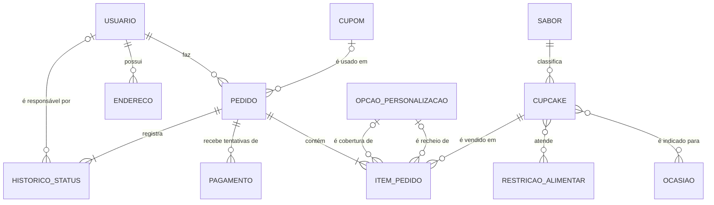

# Dados — 01. Modelo Conceitual

> Exigência atendida: **R17** (projeto conceitual a partir do diagrama de classes de persistência).
> Origem: classes de persistência em [../uml/02-classes.md](../uml/02-classes.md), seção 1.

O modelo conceitual mostra **o que** o sistema precisa guardar e como as coisas se relacionam, sem se preocupar ainda com tabelas, tipos ou chaves. Cada classe de persistência virou uma entidade. As classes de sessão (`Carrinho`) e de serviço (`ServicoPagamento`, `GatewaySimulado`) ficaram de fora porque não são armazenadas.

## 1. Diagrama Entidade-Relacionamento

Notação de pé de galinha: `||` exatamente um · `o|` zero ou um · `|{` um ou mais · `o{` zero ou mais.

`AREA_ENTREGA` não aparece ligada a nenhuma entidade de propósito: o pedido guarda uma **cópia** do frete e do prazo calculados no momento da compra (ver M3 no diagrama de classes). Se a loja mudar o valor do frete amanhã, os pedidos de hoje não podem mudar.

## 2. Entidades

| Entidade | O que representa | Exemplos |
|---|---|---|
| USUARIO | Pessoa com conta: cliente ou administrador da loja | Ana Paula Souza (cliente) |
| ENDERECO | Endereço de entrega cadastrado por um cliente | Casa — Av. Paulista, 1000 |
| SABOR | Família de sabor usada no filtro da vitrine | Chocolate, Frutas |
| OCASIAO | Ocasião para a qual o cupcake é indicado | Aniversário, Casamento |
| RESTRICAO_ALIMENTAR | Restrição atendida pelo cupcake | Sem lactose, Vegano |
| CUPCAKE | Produto do cardápio | Red Velvet, R$ 12,90 |
| OPCAO_PERSONALIZACAO | Recheio ou cobertura que o cliente pode escolher | Ganache (+ R$ 1,50) |
| CUPOM | Código promocional | DOCE10 — 10% |
| AREA_ENTREGA | Faixa de CEP atendida, com frete e prazo | Centro — R$ 8,00, 90 min |
| PEDIDO | Compra feita por um cliente | #000128 — R$ 63,35 |
| ITEM_PEDIDO | Cada linha do pedido, com quantidade, personalização e preço da época | 2 × Red Velvet |
| PAGAMENTO | Cada tentativa de pagamento de um pedido | Cartão Visa final 1111 — aprovado |
| HISTORICO_STATUS | Cada mudança de etapa do pedido | 14:10 — Em preparo |

## 3. Relacionamentos e cardinalidades

| Relacionamento | Cardinalidade | Leitura | Regra de origem |
|---|---|---|---|
| USUARIO possui ENDERECO | 1 : N | Um usuário tem zero ou vários endereços; cada endereço é de um único usuário | RN18 |
| USUARIO faz PEDIDO | 1 : N | Um cliente faz zero ou vários pedidos; cada pedido é de um único cliente | US13 |
| SABOR classifica CUPCAKE | 1 : N | Todo cupcake tem exatamente um sabor; um sabor agrupa vários cupcakes | US02 |
| CUPCAKE é indicado para OCASIAO | N : N | Um cupcake serve para várias ocasiões e uma ocasião tem vários cupcakes | US02 |
| CUPCAKE atende RESTRICAO_ALIMENTAR | N : N | Um cupcake pode atender várias restrições, ou nenhuma | US02 |
| PEDIDO contém ITEM_PEDIDO | 1 : N (mín. 1) | Não existe pedido sem item | UC10 |
| CUPCAKE é vendido em ITEM_PEDIDO | 1 : N | Cada item se refere a um cupcake | RN19 |
| OPCAO_PERSONALIZACAO é recheio / cobertura de ITEM_PEDIDO | 0..1 : N | O item pode ter um recheio e uma cobertura, ou nenhum | RN04 |
| CUPOM é usado em PEDIDO | 0..1 : N | O pedido usa no máximo um cupom | RN07 |
| PEDIDO recebe tentativas de PAGAMENTO | 1 : N | Um pedido pode ter várias tentativas (recusa, expiração) | RN14 |
| PEDIDO registra HISTORICO_STATUS | 1 : N (mín. 1) | Todo pedido nasce com o registro "Aguardando pagamento" | RN15 |
| USUARIO é responsável por HISTORICO_STATUS | 0..1 : N | Mudanças feitas pela loja guardam quem fez; as automáticas, não | CA17.3 |
