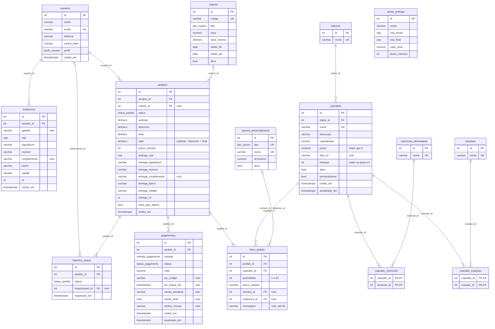

# Dados — 02. Modelo Lógico Normalizado

> Exigência atendida: **R18** (projeto lógico normalizado).
> Origem: [01-modelo-conceitual.md](01-modelo-conceitual.md). Implementação física: [`database/schema.sql`](../../../database/schema.sql).

## 1. Do diagrama de classes para o modelo relacional

O mapeamento seguiu o caminho descrito no material teórico: cada classe vira um esquema de relação, os atributos ganham **domínio** (não só tipo de dado) e as associações viram chaves estrangeiras.

| Elemento no diagrama de classes | Como ficou no modelo relacional | Exemplo |
|---|---|---|
| Classe de persistência | Tabela, com chave primária substituta `id` | `Cupcake` → `cupcakes` |
| Associação 1 : N | Chave estrangeira no lado N | `Usuario 1 → N Endereco` → `enderecos.usuario_id` |
| Associação N : N | Tabela associativa com chave primária composta | `Cupcake N ↔ N Ocasiao` → `cupcake_ocasioes` |
| Composição (losango cheio) | FK com `ON DELETE CASCADE`: a parte some junto com o todo | `Pedido ◆ ItemPedido` |
| Associação simples | FK com `ON DELETE RESTRICT`: impede apagar o que está em uso | `ItemPedido → Cupcake` (RN19) |
| Enumeração | Tipo `ENUM` do PostgreSQL | `StatusPedido` → `status_pedido` |
| Regra de negócio sobre um valor | Restrição `CHECK` ou domínio | RN03 → `CHECK (quantidade BETWEEN 1 AND 20)` |

## 2. Esquema relacional

Notação: **sublinhado** = chave primária · *itálico* = chave estrangeira · `?` = aceita nulo.

- **usuarios** (<u>id</u>, nome, email, telefone, senha_hash, perfil, criado_em)
- **enderecos** (<u>id</u>, *usuario_id*, apelido?, cep, logradouro, numero, complemento?, bairro, cidade, uf, criado_em)
- **sabores** (<u>id</u>, nome)
- **ocasioes** (<u>id</u>, nome)
- **restricoes_alimentares** (<u>id</u>, nome)
- **cupcakes** (<u>id</u>, *sabor_id*, nome, descricao, ingredientes, preco, foto_url?, estoque, ativo, personalizavel, criado_em, atualizado_em)
- **cupcake_ocasioes** (<u>*cupcake_id*, *ocasiao_id*</u>)
- **cupcake_restricoes** (<u>*cupcake_id*, *restricao_id*</u>)
- **opcoes_personalizacao** (<u>id</u>, tipo, nome, acrescimo, ativo)
- **cupons** (<u>id</u>, codigo, tipo, valor, valor_minimo, valido_de, valido_ate, ativo)
- **areas_entrega** (<u>id</u>, nome, cep_inicial, cep_final, valor_frete, prazo_minutos)
- **pedidos** (<u>id</u>, *usuario_id*, *cupom_id*?, status, subtotal, desconto, frete, total, prazo_minutos, entrega_cep, entrega_logradouro, entrega_numero, entrega_complemento?, entrega_bairro, entrega_cidade, entrega_uf, visto_pelo_admin, criado_em)
- **itens_pedido** (<u>id</u>, *pedido_id*, *cupcake_id*, quantidade, preco_unitario, *recheio_id*?, *cobertura_id*?, mensagem?)
- **pagamentos** (<u>id</u>, *pedido_id*, metodo, status, valor, pix_codigo?, pix_expira_em?, cartao_bandeira?, cartao_final?, motivo_recusa?, criado_em, atualizado_em)
- **historico_status** (<u>id</u>, *pedido_id*, status, *responsavel_id*?, registrado_em)

## 3. Diagrama lógico

## 4. Normalização

### 1ª Forma Normal: valores atômicos, sem grupos repetidos

| Situação que violaria a 1FN | Como foi resolvida |
|---|---|
| Endereço guardado num único texto | Separado em CEP, logradouro, número, complemento, bairro, cidade e UF |
| Ocasiões e restrições de um cupcake numa lista ("Aniversário, Casamento") | Tabelas associativas `cupcake_ocasioes` e `cupcake_restricoes`, uma linha por par |
| Itens do pedido numa coluna de texto ou em colunas repetidas (item1, item2…) | Tabela `itens_pedido`, uma linha por item |
| Histórico de status numa coluna de texto | Tabela `historico_status`, uma linha por mudança |

Todas as tabelas têm chave primária e nenhuma coluna guarda lista ou valor composto.

### 2ª Forma Normal: nenhum atributo depende de parte da chave

A 2FN só pode ser violada em tabelas com **chave composta**. No modelo, só as associativas têm chave composta: `cupcake_ocasioes` e `cupcake_restricoes`. Elas **não têm atributos além da própria chave**, então não existe dependência parcial. As demais tabelas têm chave simples (`id`), o que já garante a 2FN.

### 3ª Forma Normal: nenhum atributo depende de outro atributo que não seja chave

Dependências funcionais principais (X → Y significa "X determina Y"):

| Tabela | Dependências | Situação |
|---|---|---|
| usuarios | id → nome, email, telefone, senha_hash, perfil · email → id | email é chave candidata; sem dependência transitiva |
| enderecos | id → usuario_id, cep, logradouro, … | CEP **não** determina logradouro de forma confiável (CEPs gerais de cidade, condomínios), então manter os campos juntos não é dependência transitiva |
| cupcakes | id → sabor_id, nome, preco, estoque, … · nome → id | O **nome do sabor** foi para `sabores`; se ficasse em `cupcakes`, haveria id → sabor_id → nome do sabor (transitiva) |
| opcoes_personalizacao | id → tipo, nome, acrescimo · (tipo, nome) → id | Chave candidata composta; sem transitividade |
| itens_pedido | id → pedido_id, cupcake_id, quantidade, preco_unitario, … | O preço **não** vem do cupcake: é o preço cobrado naquela venda (ver exceções) |
| pagamentos | id → pedido_id, metodo, status, … | Colunas de Pix e de cartão dependem do método, mas o `CHECK` garante que só as do método certo são preenchidas |

### Decisões conscientes que parecem redundância, mas não são

| Coluna | Por que parece redundante | Por que está certo manter |
|---|---|---|
| `itens_pedido.preco_unitario` | O preço já está em `cupcakes.preco` | São fatos diferentes: o preço **atual** e o preço **cobrado na venda**. Se fosse buscado em `cupcakes`, um reajuste mudaria o valor de pedidos antigos (RN10) |
| `pedidos.entrega_*` | O endereço já está em `enderecos` | O cliente pode editar ou excluir o endereço depois (UC09). O pedido registra **para onde foi entregue**, um fato histórico |
| `pedidos.frete` e `prazo_minutos` | Poderiam ser buscados em `areas_entrega` | A loja pode mudar o frete; o pedido guarda o que foi cobrado e prometido ao cliente |
| `pedidos.subtotal`, `desconto`, `total` | O total pode ser calculado a partir dos itens | É o **valor efetivamente cobrado**, usado no pagamento e no histórico. Para evitar inconsistência, o banco obriga `total = subtotal − desconto + frete` com uma restrição `CHECK` |

Essas quatro decisões não quebram a 3FN, porque cada coluna depende só da chave do pedido (ou do item) **no momento da compra**. Elas também estão justificadas no diagrama de classes (M1 a M3).

## 5. Integridade garantida pelo próprio banco

A maior parte das regras é conferida também pela aplicação, mas as críticas ficaram no banco. Assim, mesmo um erro de programação não consegue gravar um dado inválido.

| Regra | Como o banco garante |
|---|---|
| RN01 — preço > 0, estoque ≥ 0 | `CHECK` em `cupcakes` |
| RN03 — quantidade de 1 a 20 | `CHECK` em `itens_pedido` |
| RN04 — mensagem até 60 caracteres; recheio é recheio e cobertura é cobertura | `VARCHAR(60)` + FK composta `(recheio_id, 'RECHEIO')` → `opcoes_personalizacao (id, tipo)` |
| RN07 — desconto nunca maior que o subtotal; percentual até 100 | `CHECK` em `pedidos` e `cupons` |
| RN08 — faixas de CEP sem sobreposição | Restrição de exclusão (`EXCLUDE USING gist`) em `areas_entrega` |
| RN09 — total = subtotal − desconto + frete | `CHECK` em `pedidos` |
| RN12 — só os 4 últimos dígitos do cartão | `CHAR(4)` com `CHECK` de 4 dígitos; não existe coluna para número completo ou CVV |
| RN14 — no máximo um pagamento aprovado por pedido | Índice único parcial `WHERE status = 'APROVADO'` |
| RN17 — e-mail único sem diferenciar maiúsculas | Índice único em `lower(email)` |
| RN19 — cupcake vendido não pode ser excluído | FK `ON DELETE RESTRICT` de `itens_pedido` para `cupcakes` |
| Pix e cartão com os campos corretos | `CHECK` em `pagamentos` conforme o método |

Os testes dessas restrições estão em [04-verificacao-do-banco.md](04-verificacao-do-banco.md).
