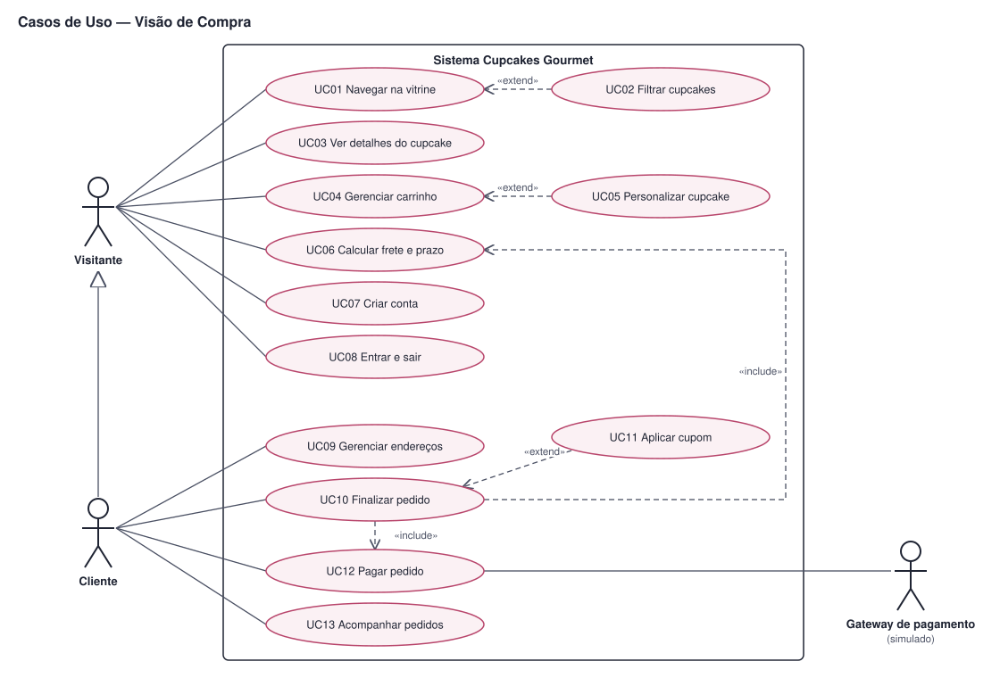
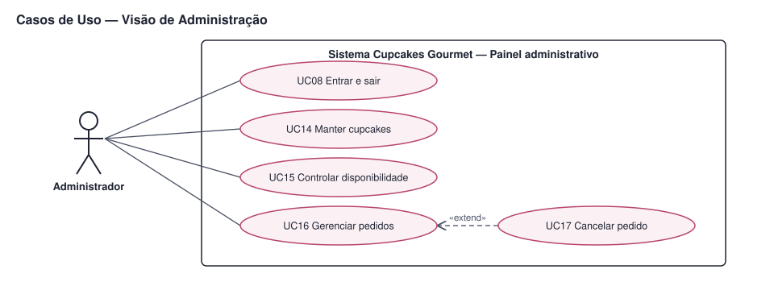

# UML — Diagrama de Casos de Uso

> Exigência atendida: **R07** (diagrama de casos de uso geral).
> O detalhamento de cada caso de uso está em [04-casos-de-uso-expandidos.md](../04-casos-de-uso-expandidos.md).
> Os diagramas são gerados pelo script [fontes/gerar_casos_de_uso.py](fontes/gerar_casos_de_uso.py), em notação UML (atores, casos de uso e fronteira do sistema).

Para facilitar a leitura, o diagrama geral foi dividido em duas visões do mesmo sistema: **Compra** (visitante, cliente e gateway) e **Administração** (administrador).

## 1. Visão de compra

## 2. Visão de administração

## 3. Atores

| Ator | Tipo | Descrição |
|---|---|---|
| Visitante | Primário | Pessoa sem login. Navega, monta o carrinho, estima o frete, cria conta e faz login |
| Cliente | Primário | Visitante autenticado. Herda tudo do visitante e também finaliza pedidos, paga e acompanha |
| Administrador | Primário | Funcionário da loja. Mantém o catálogo e gerencia os pedidos |
| Gateway de pagamento (simulado) | Secundário | Sistema externo que aprova, recusa ou expira pagamentos. No MVP é um módulo interno que imita esse comportamento |

## 4. Relacionamentos usados

| Relação | Significado neste diagrama |
|---|---|
| Associação (linha contínua) | O ator inicia ou participa do caso de uso |
| Generalização (Cliente → Visitante) | O cliente pode fazer tudo o que o visitante faz |
| «include» | O caso de uso base **sempre** executa o incluído (ex.: finalizar pedido sempre calcula o frete) |
| «extend» | O caso de uso estendido acontece **opcionalmente** dentro do base (ex.: aplicar cupom é opcional ao finalizar) |

## 5. Rastreabilidade casos de uso × histórias

| Caso de uso | Histórias | Ator principal |
|---|---|---|
| UC01 Navegar na vitrine | US01 | Visitante |
| UC02 Filtrar cupcakes | US02 | Visitante |
| UC03 Ver detalhes do cupcake | US03 | Visitante |
| UC04 Gerenciar carrinho | US04, US06 | Visitante |
| UC05 Personalizar cupcake | US05 | Visitante |
| UC06 Calcular frete e prazo | US11 | Visitante |
| UC07 Criar conta | US13 | Visitante |
| UC08 Entrar e sair | US13, US17 (acesso ao painel) | Visitante, Administrador |
| UC09 Gerenciar endereços | US10 | Cliente |
| UC10 Finalizar pedido | US06, US11 | Cliente |
| UC11 Aplicar cupom | US07 | Cliente |
| UC12 Pagar pedido | US08, US09 | Cliente |
| UC13 Acompanhar pedidos | US12, US13 | Cliente |
| UC14 Manter cupcakes | US15 | Administrador |
| UC15 Controlar disponibilidade | US16 | Administrador |
| UC16 Gerenciar pedidos | US17 | Administrador |
| UC17 Cancelar pedido | US17 | Administrador |

Todas as 16 histórias do MVP estão cobertas por pelo menos um caso de uso.
