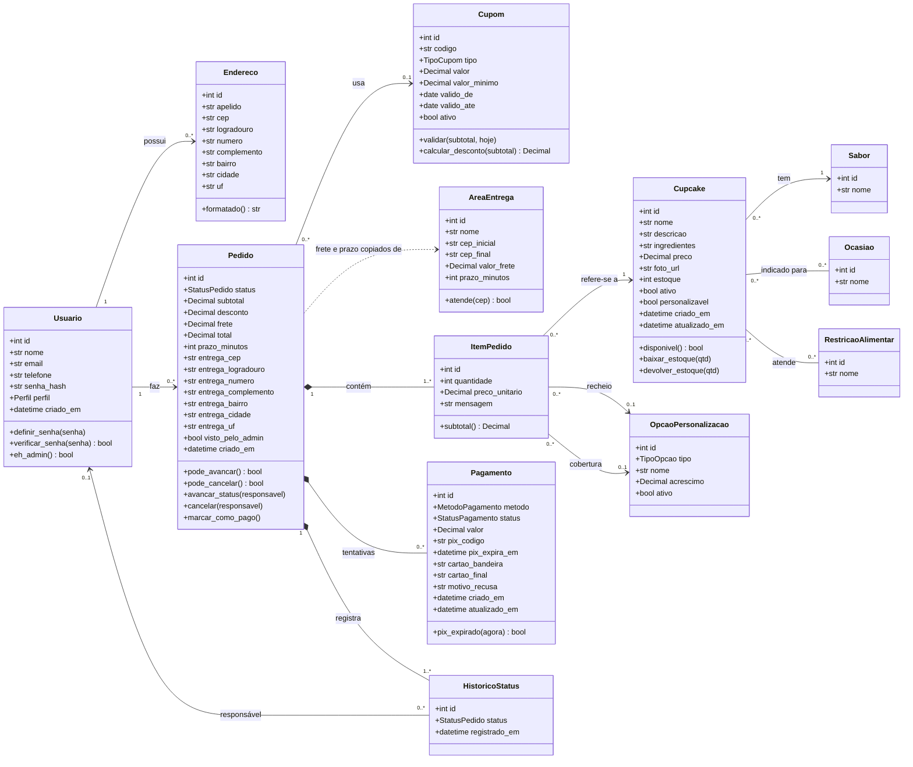
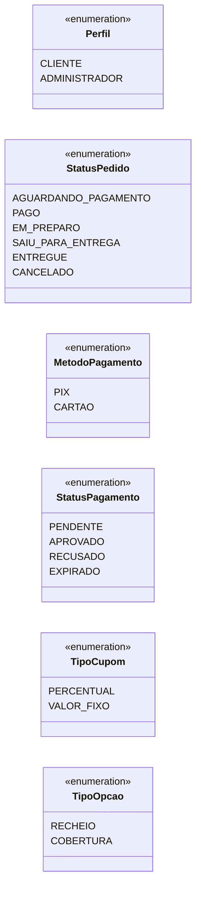
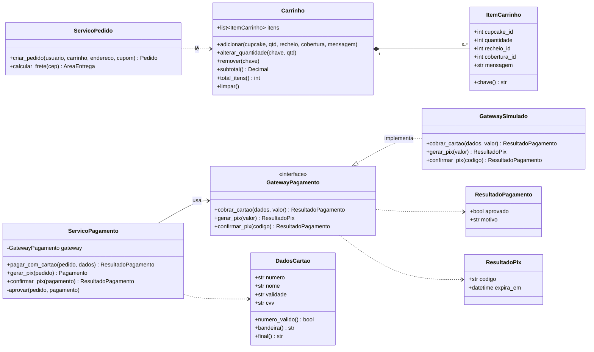
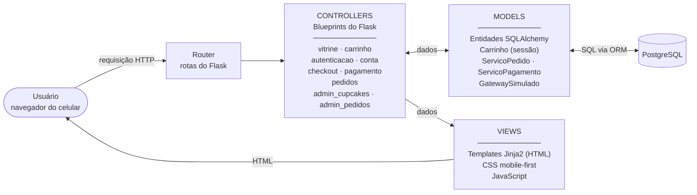

# UML — Diagrama de Classes e Arquitetura MVC

> Exigência atendida: **R09** (diagrama de classes, incluindo as classes de persistência que dão origem ao banco de dados).
> As classes de persistência (seção 1) são a base do projeto de dados: [dados/](../dados/).
> Diagramas em Mermaid (o GitHub exibe como imagem). Versões em SVG na pasta [img/](img/).

## 1. Classes de persistência (modelo de domínio)

Classes que viram tabelas no banco. Tipos em Python: `str`, `int`, `bool`, `Decimal` (valores em reais), `date` e `datetime`.

### Enumerações

### Decisões de modelagem

| # | Decisão | Motivo |
|---|---|---|
| M1 | `ItemPedido.preco_unitario` guarda o preço no momento da compra, já com os acréscimos | RN10: mudança de preço no catálogo não altera pedidos feitos |
| M2 | `Pedido` guarda uma **cópia** do endereço de entrega (`entrega_*`) em vez de apontar para `Endereco` | O cliente pode editar ou excluir o endereço depois (UC09); o pedido precisa manter o endereço usado na entrega |
| M3 | `Pedido` guarda `subtotal`, `desconto`, `frete` e `total` | Registro do valor efetivamente cobrado, que não pode mudar se cupom, frete ou preços mudarem depois |
| M4 | `Pagamento` é uma classe separada, com várias tentativas por pedido | RN14: depois de recusa ou expiração, o cliente pode tentar de novo; cada tentativa fica registrada |
| M5 | `Pagamento` guarda só `cartao_bandeira` e `cartao_final` | RN12 e RNF05: nunca armazenar número completo nem código de segurança |
| M6 | `HistoricoStatus` registra cada mudança de status com data, hora e responsável | Linha do tempo do cliente (CA12.1) e auditoria da loja (CA17.3) |
| M7 | `Sabor`, `Ocasiao` e `RestricaoAlimentar` são classes, não texto livre | Filtros consistentes (US02) e normalização do banco |
| M8 | `Pedido.visto_pelo_admin` | Destaque de pedidos novos no painel (CA17.6) |

## 2. Classes de sessão e de serviço (não persistidas)

Classes que **não** viram tabelas: o carrinho fica na sessão do usuário e o pagamento usa um serviço com gateway trocável.

**Por que uma interface `GatewayPagamento`?** O MVP usa o `GatewaySimulado` (RN11). Para usar um gateway real no futuro, basta criar outra classe que implemente a mesma interface, sem mexer em controllers nem em telas.

## 3. Arquitetura MVC

Mesma estrutura da Figura 2 do material teórico (Usuário → Router → Controller ↔ Model; Controller → View → HTML).

| Camada | Responsabilidade | Não pode |
|---|---|---|
| **Model** | Regras de negócio (RN01–RN21), validação dos dados e acesso ao banco | Conhecer HTML ou requisições HTTP |
| **View** | Apresentar dados e coletar entradas; validação visual imediata em JavaScript | Conter regra de negócio (a regra sempre é conferida de novo no Model) |
| **Controller** | Receber a requisição, chamar o Model, escolher a View e tratar erros | Acessar o banco diretamente |
