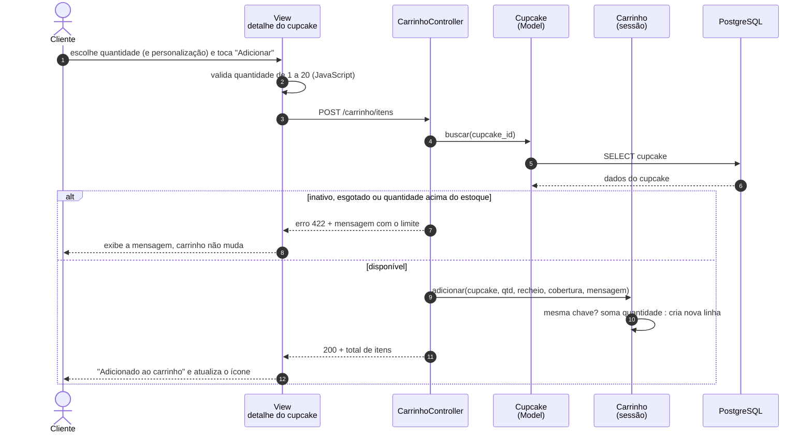
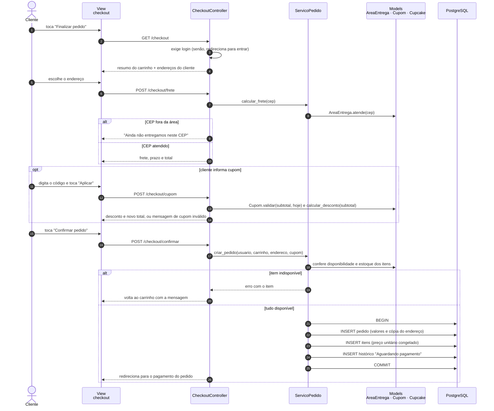
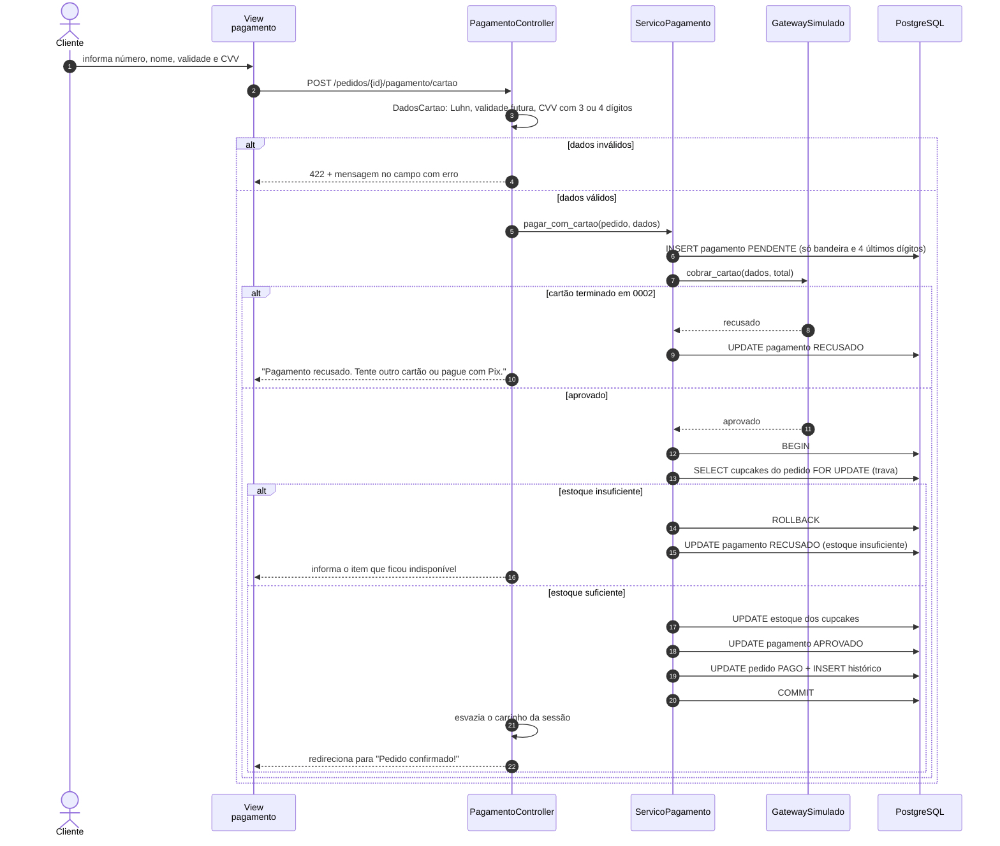
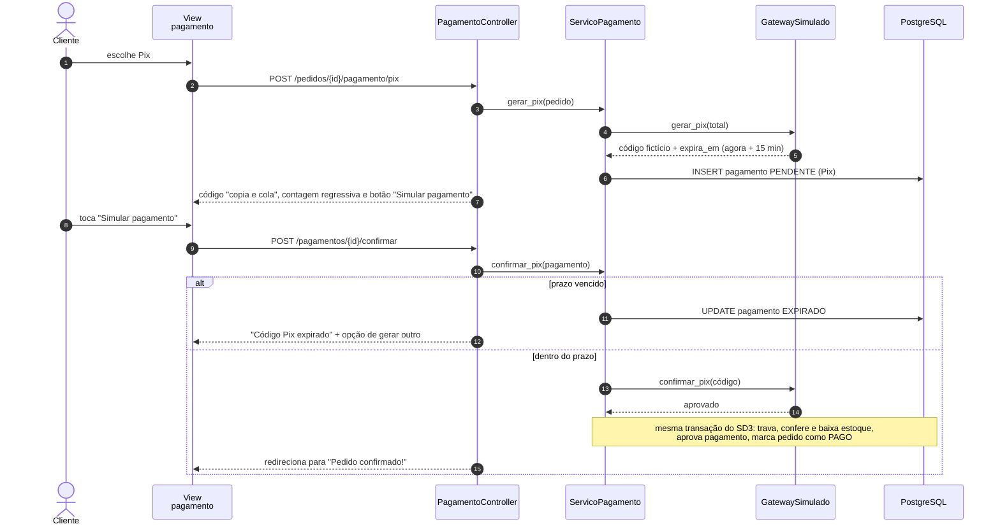
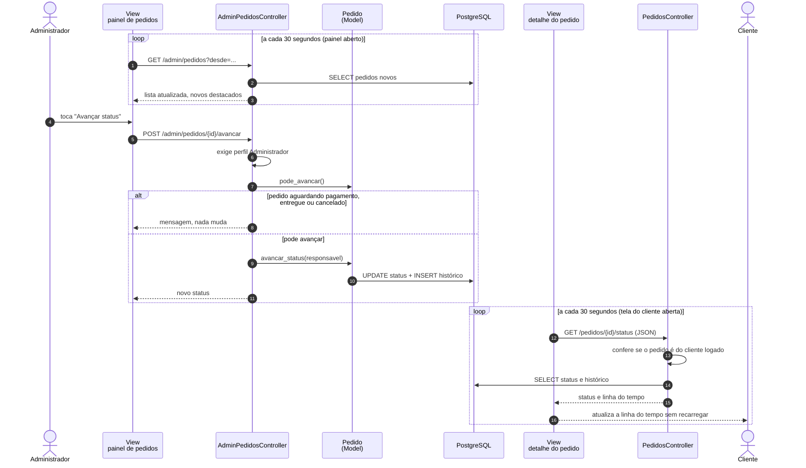

# UML — Diagramas de Sequência

> Exigência atendida: **R10** (diagramas de sequência).
> Mostram a troca de mensagens entre View, Controller e Model (arquitetura MVC) nos fluxos mais críticos do sistema.

| # | Diagrama | Casos de uso | Por que foi escolhido |
|---|---|---|---|
| SD1 | Adicionar ao carrinho | UC04, UC05 | Fluxo mais usado do app |
| SD2 | Finalizar pedido | UC10, UC06, UC11 | Congela preços e endereço e cria o pedido |
| SD3 | Pagar com cartão | UC12 | Fluxo crítico: transação, trava de estoque e dados sensíveis |
| SD4 | Pagar com Pix | UC12 (FA1) | Regra de expiração em 15 minutos |
| SD5 | Atualizar e acompanhar status | UC16, UC13 | Integração entre painel da loja e tela do cliente |

## SD1 — Adicionar ao carrinho

## SD2 — Finalizar pedido

## SD3 — Pagar com cartão (simulado)

> Os dados completos do cartão existem só na memória durante a requisição e nunca são gravados (RN12).

## SD4 — Pagar com Pix (simulado)

## SD5 — Atualizar status (loja) e acompanhar (cliente)

