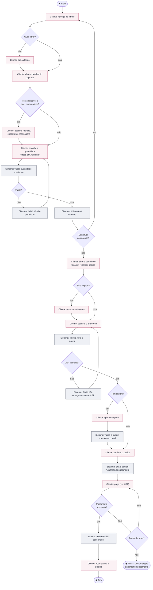
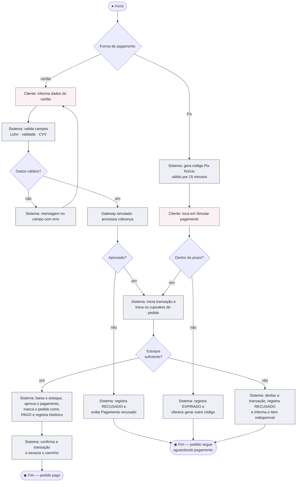
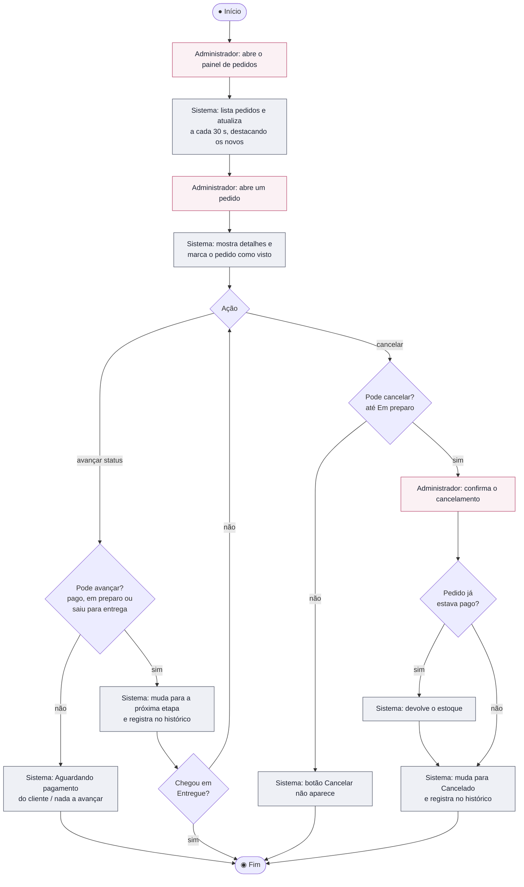
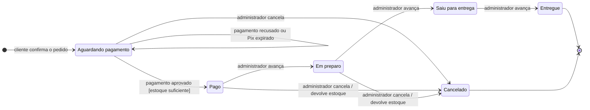
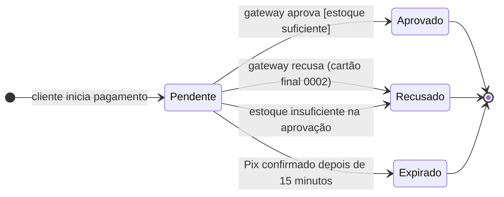

# UML — Diagramas de Atividades e de Estados

> Exigência atendida: **R11** (diagramas de atividades). Também inclui os diagramas de **máquina de estados** do pedido e do pagamento, que deixam explícitas as regras RN14, RN15 e RN16.
> Legenda das atividades: caixas rosadas = ação do ator · caixas cinzas = ação do sistema · losangos = decisão.

## AD1 — Processo de compra

## AD2 — Processamento do pagamento

## AD3 — Atendimento do pedido pela loja

## DE1 — Máquina de estados do Pedido

| Regra | Onde aparece |
|---|---|
| RN14 — recusa ou expiração mantém o pedido aguardando | Transição AG → AG |
| RN13 — estoque conferido na aprovação | Condição [estoque suficiente] em AG → PG |
| RN15 — etapas só avançam, sem voltar | Não há transições de volta |
| RN16 — cancelamento até "Em preparo", com devolução de estoque se pago | Transições para Cancelado só a partir de AG, PG e EP |

## DE2 — Máquina de estados do Pagamento

Cada tentativa de pagamento é um registro novo. Depois de uma recusa ou expiração, uma nova tentativa começa de novo em "Pendente".
